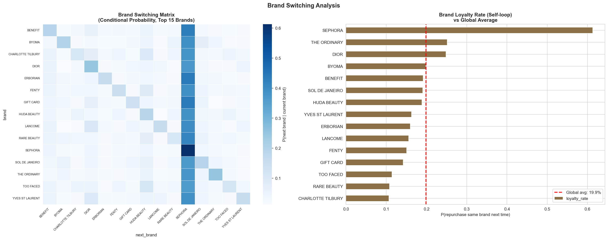
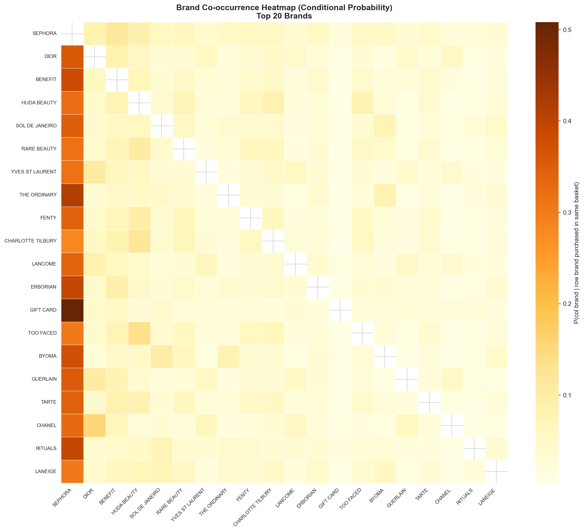
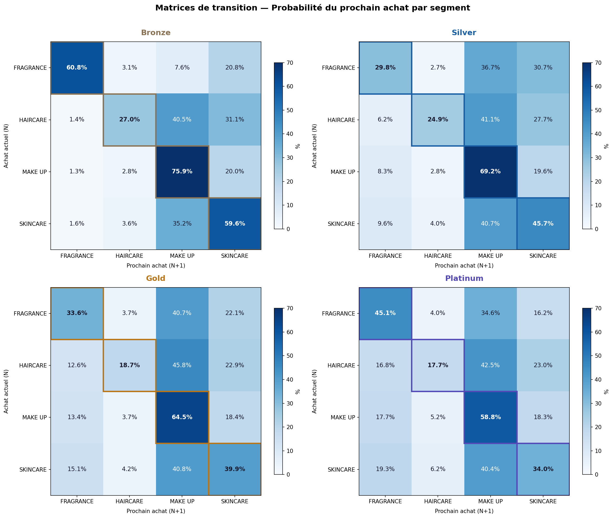
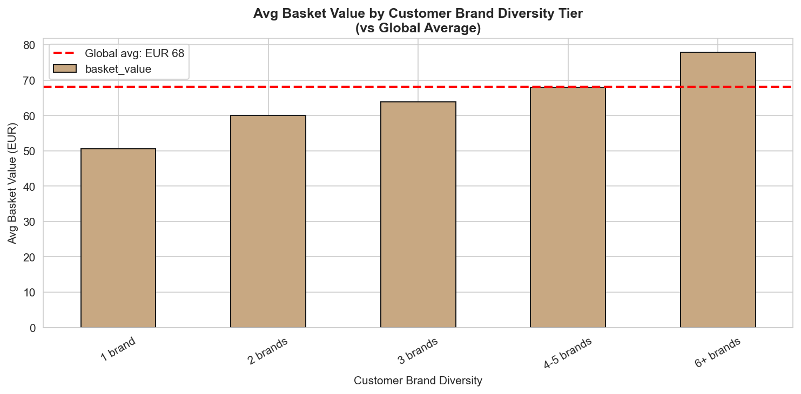
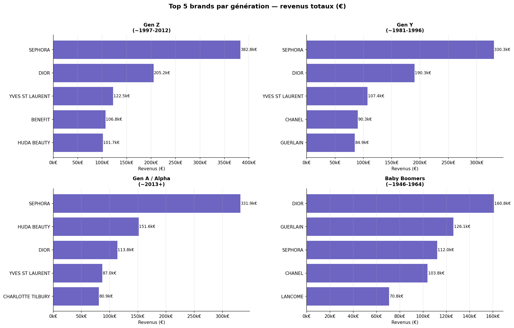
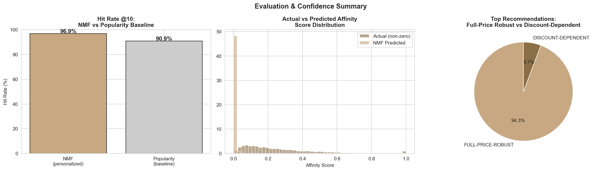

# 💄 Sephora — Brand affinity detection for cross-sell

> **Which brand should Sephora recommend next, to which customer, and why?** — including brands the customer has never bought.

**Albert School × Sephora business case · March–April 2026 · Group 11**

> Data (anonymised sample of ~65,000 French customers, 2025) belongs to Sephora and is **not** included. Notebooks are published without outputs.

---

## Analysis
- **Cleaning & features** — ticket-level aggregation, purchase timing (`days_to_next_purchase`), subscription & first-purchase flags, customer history.
- **Value segmentation** — Bronze / Silver / Gold / Platinum customer scoring; markets and brands per segment and per generation.
- **Basket affinity** — Apriori **association rules** (lift, diversity) between brands and product axes.
- **Sequential behaviour** — **transition matrices** purchase N → N+1 (brand switching, trade-up, value of the next ticket).
- **Prediction** — Random Forest models for next-purchase timing and next brand/axis.
- **Activation** — final **targeting table of 894 rules** mapping each profile to its next recommended axis × brand, ready for CRM / app recommendations.
- Board-style presentation script (`notebooks/speaker.ipynb`).

## Selected figures
| | |
|---|---|
|  |  |
| *Brand switching matrix & loyalty rate vs average* | *Brand co-occurrence in baskets* |
|  |  |
| *Purchase N → N+1 transition matrices* | *Basket lift & diversity of recommended rules* |
|  |  |
| *Top brands by generation* | *Model evaluation summary* |

More: [`figures/`](figures) (profitability of transitions, discount dependence).

## Stack
`Python` `pandas` `scikit-learn` `mlxtend (Apriori)` `matplotlib` `seaborn` `Jupyter`

---

### 🇫🇷 En bref
Cas Sephora (2026) : détecter les affinités de marques pour recommander la prochaine marque à chaque client. Segmentation de valeur, règles d'association (Apriori), matrices de transition entre achats, Random Forest et table de ciblage finale de 894 règles. Données Sephora non publiées.
